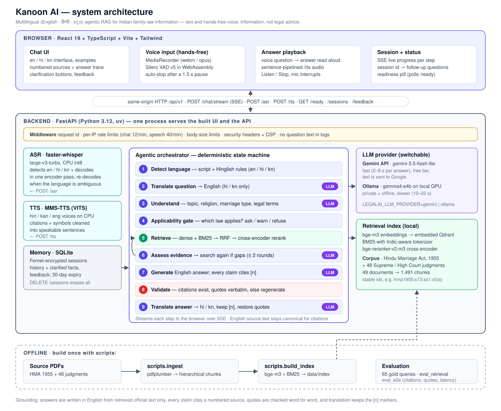

# Kanoon AI — Multilingual Family-Law Information Assistant

Ask a question about Indian family law in **English, Hindi or Kannada**, by typing or by voice,
and get an answer that quotes the law and cites numbered sources. A spoken question gets a spoken
answer.

Kanoon AI is a research prototype of an **agentic RAG** (retrieval-augmented generation) system.
Every answer is written from retrieved official text: the Hindu Marriage Act, 1955 and 48
Supreme Court and High Court judgments. The citations and quotations are checked before the
answer is shown.

> **Disclaimer:** Kanoon AI gives general legal **information**, not legal advice, and is not a
> substitute for a qualified lawyer. In an emergency call **112**, the women's helpline **181**, or
> NALSA free legal aid **15100**.



## Features

- **Three languages.** English, हिन्दी and ಕನ್ನಡ for questions, answers and the interface. Hinglish
  (Hindi in Latin script) is detected too.
- **Hands-free voice.** Press 🎤 and speak. An in-browser voice-activity detector (Silero VAD)
  sends the question when you pause, and the answer is read aloud in your language.
- **Grounded answers.** The answer is drafted in English from the retrieved text. Every claim
  cites a numbered source, and quotations are verified word for word. The answer is then
  translated, keeping the `[n]` markers and the original English quotations.
- **Applicability check.** The Hindu Marriage Act covers only some marriages. If your religion or
  marriage type matters, the assistant asks first. It does not guess.
- **Hybrid retrieval.** bge-m3 dense vectors + BM25 → reciprocal-rank fusion → bge-reranker
  cross-encoder, with up to two retrieval rounds when the evidence has gaps.
- **Conversation memory.** Follow-up questions work. Sessions are encrypted at rest and erased
  with one click.
- **Choice of LLM.** Use the **Gemini API** (fast, free tier) or a **local model through Ollama**
  (private, offline).
- **Transparent.** Live progress while it works, plus a per-answer trace: language, model, steps
  and timings.

## How a question is answered

1. **Detect the language** from the script, with rules for Hinglish.
2. **Translate the question** to English (Hindi and Kannada only).
3. **Understand it.** One LLM call returns JSON: topic, religion, marriage type, whether it is in
   scope, and up to three statutory phrases (for example *pendente lite*). Those phrases bridge lay
   wording and legal wording.
4. **Applicability gate.** It decides which law governs. It may ask a clarifying question, show an
   emergency notice, or decline out-of-scope questions.
5. **Retrieve.** Hybrid search over leaf chunks (sections, clauses, provisos and judgment
   paragraphs), then rerank.
6. **Assess the evidence.** An LLM check looks for gaps and runs a second search if needed
   (at most 2 rounds).
7. **Generate** an English answer from the evidence only, with `[n]` citations.
8. **Validate.** Every `[n]` must exist and every quotation must appear verbatim in its source.
   Otherwise the answer is regenerated or flagged.
9. **Translate the answer** back to Hindi or Kannada, then restore the verified English
   quotations.

Every step streams to the browser over Server-Sent Events. Read more in
[`docs/architecture.md`](docs/architecture.md).

## Tech stack

| Layer | Technology |
|---|---|
| Frontend | React 19, TypeScript, Vite, Tailwind CSS 4, Vitest |
| Voice in the browser | MediaRecorder, `@ricky0123/vad-web` (Silero VAD v5 on onnxruntime-web) |
| Backend | FastAPI, Python 3.12, uv, pydantic-settings, structlog |
| LLM | Google Gemini API (`gemini-3.5-flash-lite`) or Ollama (`gemma4:e4b`) |
| Retrieval | BAAI bge-m3 embeddings, embedded Qdrant, BM25, BAAI bge-reranker-v2-m3 |
| Speech | faster-whisper `large-v3-turbo` (ASR, CPU int8), Meta MMS-TTS (hin / kan / eng) |
| Storage | SQLite with Fernet encryption (sessions, feedback) |
| Ingestion | pdfplumber, hierarchical chunking with stable chunk ids |
| Quality | pytest, ruff, mypy (strict), GitHub Actions CI |

## Quick start (Windows / PowerShell)

### 1. Prerequisites

- Python 3.11+ (3.12 recommended) and [uv](https://docs.astral.sh/uv/)
- Node.js 20+ and npm
- An LLM: either a [Gemini API key](https://aistudio.google.com/apikey) (free tier) **or**
  [Ollama](https://ollama.com) with `ollama pull gemma4:e4b`
- About 10 GB of disk for model weights. A CUDA GPU speeds up embedding and reranking, but the
  app also runs on CPU.

### 2. Install

```powershell
git clone https://github.com/Pranjal-ctr/Legal-AI.git
cd Legal-AI
uv sync --extra dev --extra ingest --extra embed --extra speech
Copy-Item .env.example .env
cd frontend; npm install; cd ..
```

### 3. Choose the LLM (in `.env`)

```dotenv
# Gemini API: fast; questions are sent to Google
LEGALAI_LLM_PROVIDER=gemini
LEGALAI_GEMINI_API_KEY=your-key-here
LEGALAI_GEMINI_MODEL=gemini-3.5-flash-lite

# or local and private
# LEGALAI_LLM_PROVIDER=ollama
# LEGALAI_OLLAMA_MODEL=gemma4:e4b
```

`uv run python -m scripts.check_gemini` checks the key and lists the models it can use.

### 4. Add the corpus and build the index

The source PDFs are not in the repository. Put the judgment PDFs in `data/family_law_dataset/`
and the Hindu Marriage Act in `data/raw/hma1955.pdf` (provenance is in
[`data/manifest.json`](data/manifest.json)). Then:

```powershell
uv run python -m scripts.ingest        # PDFs → data/processed/{documents,chunks}.jsonl
uv run python -m scripts.build_index   # bge-m3 + BM25 → data/index (stop the API first)
```

### 5. Run

```powershell
.\scripts\start.ps1        # builds the UI and serves UI + API at http://127.0.0.1:8000
```

For development, use two terminals: `uv run python -m app` (API with auto-reload, docs at
`/docs`) and `cd frontend; npm run dev` (UI at <http://localhost:5173>). Docker Compose is
described in [`docs/deployment.md`](docs/deployment.md).

Models load in the background at startup. The status pill in the header turns green when
answers are ready.

## Using it

- **Type** a question, or click one of the example questions. With **Auto-detect**, the language
  is detected for you, or you can pick one.
- **Speak.** Press **🎤 Speak**, ask your question, and pause. It sends itself, and the answer is
  shown and read aloud. Press 🎤 again to interrupt the reading.
- Click a **[n]** marker to see the exact source text, page and court. **Show English original**
  shows the verified English answer behind a translation.
- **New conversation** erases the session on the server.

Typical latency with Gemini: 2–8 s per text answer. A voice round trip takes about 20 s, mostly
CPU speech recognition. With local Ollama on an 8 GB laptop GPU, a text answer takes 10–20 s.

## Evaluation

| Retrieval (k = 6) | hit | recall |
|---|---|---|
| English, 20 gold queries: dense only | 0.75 | 0.70 |
| English: hybrid + rerank (fuse) | **0.85** | **0.82** |
| Hindi / Kannada, 40 gold queries: hybrid + translation + rerank | **0.90** | **0.88** |

`scripts/eval_e2e.py` runs all 65 gold queries (English, lay-language, Hindi and Kannada) through
the real orchestrator. It reports citation accuracy, gold evidence among the cited sources,
quotation verification, translation integrity, clarification rate and latency (p50 / p95). The
end-to-end report is still being completed (see the status table below).

```powershell
uv run python -m scripts.eval_retrieval   # retrieval metrics → reports/
uv run python -m scripts.eval_e2e         # end-to-end answer metrics → reports/e2e_eval.{json,md}
```

## Project layout

```text
backend/app/
  agents/       orchestrator (state machine), query understanding, applicability gate, validation
  retrieval/    corpus loader, BM25, Qdrant vector store, hybrid retriever + reranking
  providers/    LLM (Ollama, Gemini), embeddings, reranker, translation, ASR, TTS
  rag/          prompt + evidence assembly, citation checks, orchestrator factory
  nlp/          language detection, legal glossary, speakable text
  memory/       encrypted SQLite sessions and feedback
  ingestion/    PDF extraction, statute + judgment parsing, hierarchical chunking
  api/v1/       /health /ready /chat /chat/stream /sessions /asr /tts /feedback
  core/         settings, logging, middleware, security, static UI serving
frontend/src/   React UI: components/, hooks/ (chat, recorder + VAD, speaker), i18n.ts, services/
scripts/        ingest, build_index, eval_retrieval, eval_e2e, check_gemini, start.ps1
tests/          unit/ and integration/ (pytest, with fake LLM / embedder / Qdrant)
data/           manifest.json, evaluation/ gold queries (raw PDFs + index are git-ignored)
docs/           architecture, security, deployment, ADRs 0001–0013
```

## Tests and quality

```powershell
uv run pytest; uv run ruff check .; uv run ruff format --check .; uv run mypy
cd frontend; npm test; npm run typecheck; npm run build
```

CI (GitHub Actions) runs the same checks on every push. The backend tests run without GPU models
because they use fakes.

## Security and privacy

- No accounts. Run it on localhost or behind an authenticating proxy.
- Per-IP rate limits, request-size limits, strict security headers and a production CSP.
- Sessions and feedback are encrypted at rest. Logs never contain question text.
- With the **Gemini** provider, question and answer text is sent to Google, and the free tier may
  use it to improve Google's products. Use **Ollama** to keep everything on your machine.

See [`docs/security.md`](docs/security.md).

## Documentation

- [`docs/architecture.md`](docs/architecture.md): components, request flow, design decisions
- [`docs/security.md`](docs/security.md): threat model and controls
- [`docs/deployment.md`](docs/deployment.md): one-command start, Docker Compose, resource needs
- [`docs/adr/`](docs/adr): architecture decision records, one per significant change

## Status and limitations

| Done | Remaining |
|---|---|
| Ingestion, hybrid RAG, multilingual, agentic orchestrator, memory, ASR + TTS, hands-free voice, UI, security, Gemini provider, one-command start | Finish the end-to-end evaluation report, Docker image build test, research write-up |

- The corpus is limited to the Hindu Marriage Act, 1955 and 48 judgments. Other laws (Special
  Marriage Act, PWDVA, BNSS maintenance) are recognised by the applicability gate but not yet
  indexed.
- The Hindi and Kannada glossary and UI strings are drafts and have not been reviewed by a
  legal translator.
- Small LLMs can still mistranslate. The English original is always one click away.

## Data and model licences

The judgments and statute are public court and government documents. Their sources are listed in
`data/manifest.json`. Meta MMS-TTS voices are licensed **CC-BY-NC 4.0**, which means
non-commercial use only. Check each model's licence before any deployment.
