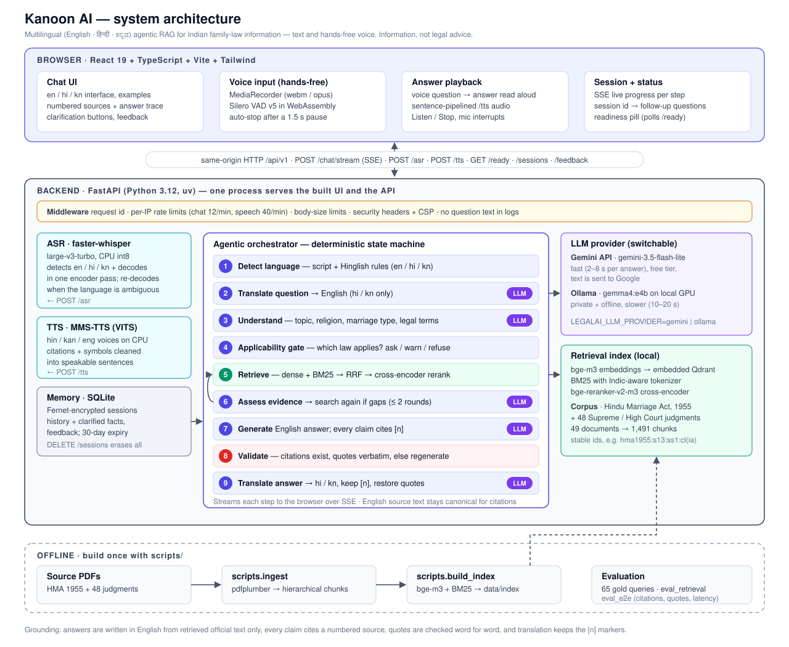

# Kanoon AI — Architecture

Multilingual (English / Hindi / Kannada) agentic RAG system that gives source-grounded
**information** about Indian family law. It is not a lawyer and does not give legal advice.
This document describes the system **as built**. The reasons for each decision are in
[`adr/`](adr/).



## Guiding principles

1. **Deterministic pipeline, LLM agents only where they earn their place.** The orchestrator is an
   explicit state machine. The LLM is used for query understanding, translation, evidence
   assessment and answer generation, and nothing decides its own control flow beyond a bounded
   second retrieval round (ADR 0006).
2. **Applicability before answering.** Which law applies depends on religion and marriage type:
   the Hindu Marriage Act (HMA), the Special Marriage Act (SMA), the Indian Divorce Act, or Muslim
   personal law. Secular laws (PWDVA, BNSS s.144 maintenance, the Dowry Prohibition Act) apply to
   everyone. When facts are missing, the system asks instead of assuming.
3. **English official text is canonical.** Citations and quotations always point to the English
   source. Hindi and Kannada are used for understanding the question and explaining the answer,
   never as a reworded source.
4. **Verify, don't trust.** Every `[n]` citation must exist. Every quotation must be verbatim in its
   cited source. Translations must keep every marker. Failures trigger a regeneration or a visible
   warning.
5. **Provider abstraction.** LLM, embedding, reranker, translation, ASR and TTS are protocols
   chosen through configuration (`LEGALAI_*` settings).
6. **Privacy by default.** Encrypted sessions, no question text in logs, and a fully local option
   (Ollama).

## Components

### Browser (`frontend/`)

React 19 + TypeScript + Vite + Tailwind.

- `Chat.tsx`: conversation view, sources, clarification buttons, trace, feedback, en/hi/kn UI
  strings (`i18n.ts`).
- `useChat`: posts to `/chat/stream` and renders live progress events. It keeps the `session_id`
  for follow-up questions.
- `useRecorder`: MediaRecorder captures the question. **Silero VAD v5** runs in WebAssembly
  (`@ricky0123/vad-web`, loaded lazily) on the same audio stream and stops the recording 1.5 s
  after you stop talking (ADR 0013). The audio is posted to `/asr`, and the transcript is sent as
  a question straight away.
- `useSpeaker`: sentence-pipelined playback from `/tts`. It plays automatically for spoken
  questions, and on demand (**Listen**) for typed ones.
- `useReadiness`: polls `/ready` for the header status pill (answers, speech input, speech output).

### Backend (`backend/app/`)

FastAPI. In production one process serves the built UI and the API from the same origin
(`core/frontend.py`).

| Endpoint | Purpose |
|---|---|
| `GET /api/v1/health`, `GET /api/v1/ready` | liveness; model readiness for the status pill |
| `POST /api/v1/chat`, `POST /api/v1/chat/stream` | answer a question (JSON, or SSE with progress events) |
| `GET / DELETE /api/v1/sessions/{id}` | read or erase a conversation |
| `POST /api/v1/asr` | speech → text (multipart audio) |
| `POST /api/v1/tts` | text → `audio/wav` |
| `POST /api/v1/feedback` | 👍 / 👎 on an answer (encrypted, erased with the session) |

**Middleware** (`core/middleware.py`, `core/security.py`): request ids, per-IP sliding-window rate
limits (chat 12/min, speech 40/min → 429), body-size limits (→ 413), security headers, a strict
CSP in production, and access logs without question text.

### Orchestrator (`agents/orchestrator.py`)

| # | Step | Module | LLM? |
|---|---|---|---|
| 1 | Detect language (script ranges, Hinglish word list) | `nlp/language.py` | no |
| 2 | Translate the question to English (hi / kn) | `providers/translation.py` | yes (light model) |
| 3 | Understand: topic, religion, marriage type, in-scope, ≤ 3 statutory `legal_terms` (JSON schema), plus regex rules for religion / SMA | `agents/understanding.py` | yes (light model) |
| 4 | Applicability gate: clarify, emergency notice, or refuse out-of-scope | `agents/applicability.py` | no |
| 5 | Retrieve: hybrid search for the question and the legal terms | `retrieval/index.py` | no |
| 6 | Assess the evidence, then optionally a second retrieval round (≤ 2 rounds) | orchestrator | yes (light model) |
| 7 | Generate the English answer from the evidence only, with `[n]` citations | `rag/prompt.py` | yes |
| 8 | Validate: citations, verbatim quotes, regenerate once if uncited | `agents/validation.py` | no |
| 9 | Translate the answer to hi / kn, check `[n]` markers, restore English quotes | `providers/translation.py` | yes |

The session history (last turns, in English) and remembered clarification facts feed step 3. When
facts conflict, the precedence is request > question > profile (ADR 0007).

### Retrieval (`retrieval/`)

- **Units:** leaf chunks, i.e. statute provisions (subsection, clause, proviso, explanation) and
  numbered judgment paragraphs. The parent section is assembled as context for the LLM.
- **First stage:** bge-m3 dense vectors in **embedded Qdrant** + **BM25** with an Indic-aware
  tokenizer, fused with reciprocal-rank fusion (30 candidates).
- **Second stage:** the bge-reranker-v2-m3 cross-encoder, *fused* with the first-stage rank rather
  than replacing it. Replacing it lost short statute clauses (ADR 0004).
- **Lay-to-legal bridge:** the understanding step's `legal_terms` (for example *pendente lite*)
  become an extra query and are appended to the rerank query. This fixed HMA s.24 not being found
  for "maintenance while the case is pending" (ADR 0011).

### LLM providers (`providers/llm.py`, `providers/gemini.py`)

| Provider | Model | Trade-off |
|---|---|---|
| `gemini` | `gemini-3.5-flash-lite` (optional lighter model for steps 2, 3, 6) | 2–8 s answers, free tier (500 requests / day), text leaves the machine |
| `ollama` | `gemma4:e4b` | private and offline. Uses ~6.6 GB of GPU memory; 10–20 s answers on an 8 GB laptop GPU |

Both use a JSON schema for structured steps. Gemini retries per-minute 429 errors after a short
wait (ADR 0012).

### Speech (`providers/asr.py`, `providers/tts.py`)

- **ASR:** faster-whisper `large-v3-turbo`, CPU int8. It detects the language and decodes in one
  encoder pass, and re-decodes with the runner-up language when detection is ambiguous. That fixes
  Kannada speech scored as Hindi and written in Devanagari (ADR 0009).
- **TTS:** Meta MMS-TTS (VITS) voices for hin / kan / eng on CPU, with an LRU cache. The answer
  text is cleaned into speakable clauses first (`nlp/speech_text.py`).

### Memory (`memory/`)

SQLite with Fernet-encrypted payloads: messages (English), clarified facts and feedback.
Sessions expire after 30 days, and `DELETE /sessions/{id}` cascades to feedback. Production
requires `LEGALAI_SESSION_KEY`.

## Offline pipeline (`scripts/`)

```text
data/raw/hma1955.pdf + data/family_law_dataset/*.pdf
  → scripts.ingest       pdfplumber, header/footer stripping, statute + judgment parsing,
                         hierarchical chunks with stable ids (hma1955:s13:ss1:cl(ia))
                         → data/processed/{documents,chunks}.jsonl   (49 docs, 1,491 chunks)
  → scripts.build_index  bge-m3 embeddings → data/index/qdrant + index_meta.json (corpus fingerprint)
  → scripts.eval_retrieval / scripts.eval_e2e   65 gold queries → reports/
```

Ingestion never guesses metadata. Missing court, date or citation stays null and is reported in
`ingest_report.json`. Source typos are kept verbatim.

## Multilingual strategy

The question is translated to English by the LLM (IndicTrans2 was deferred). Retrieval runs on
the English question + the legal terms, and bge-m3 is multilingual, so native wording still
matches. The answer is generated in English, validated, then translated. Hindi and Kannada
retrieval with translation reaches hit@6 0.90 (ADR 0005).

## Changes from the Phase 0 design

| Planned | Built | Why |
|---|---|---|
| PostgreSQL + Redis | Embedded Qdrant + SQLite | Single-machine prototype; no servers to run (ADRs 0003, 0007) |
| IndicTrans2 translation | LLM translation with marker checks | One model to host; quality was adequate for the prototype (ADR 0005) |
| Answer generated directly in the user's language | English first → validate → translate | Quotes and citations can be verified against canonical English text (ADR 0006) |
| Local LLM only | Ollama **or** Gemini API | Latency and GPU load on an 8 GB laptop (ADR 0012) |
| Manual stop for voice | In-browser VAD auto-stop | Hands-free voice questions (ADR 0013) |

## Phase status

| Phase | Scope | Status |
|---|---|---|
| 0–1 | Design; skeleton, config, logging, CI | Done |
| 2 | Ingestion: HMA 1955 + 48 judgments, gold queries (ADR 0002) | Done |
| 3–4 | Baseline RAG; hybrid retrieval + reranking (ADRs 0003, 0004) | Done |
| 5 | Multilingual (ADR 0005) | Done |
| 6–7 | Understanding, applicability gate, agentic orchestrator (ADR 0006) | Done |
| 8 | Encrypted memory (ADR 0007) | Done |
| 8b | Latency: warm-up, keep-alive, SSE progress (ADR 0008) | Done |
| 9–10 | ASR + TTS (ADR 0009) | Done |
| 11 | UI: welcome, examples, helplines, readiness, feedback | Done |
| 12 | Security (ADR 0010, [`security.md`](security.md)) | Done |
| 13 | Evaluation: retrieval done; end-to-end report in progress (ADR 0011) | In progress |
| 14 | Deployment: single-origin serving, `start.ps1`, Docker Compose ([`deployment.md`](deployment.md)) | Mostly done (Docker image not yet built) |
| — | Gemini provider (ADR 0012), hands-free voice (ADR 0013) | Done |
| 15 | Research write-up | To do |
